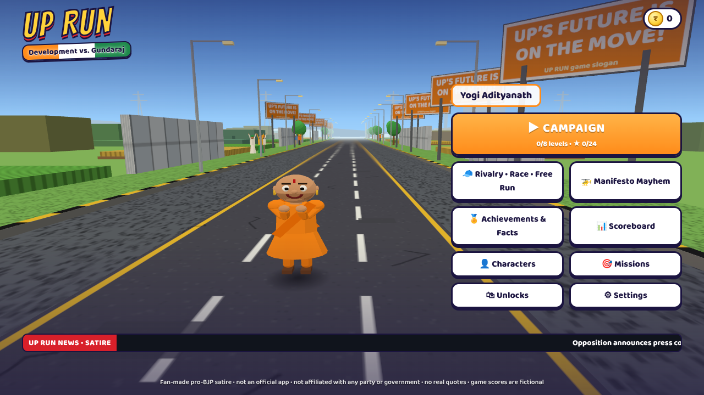
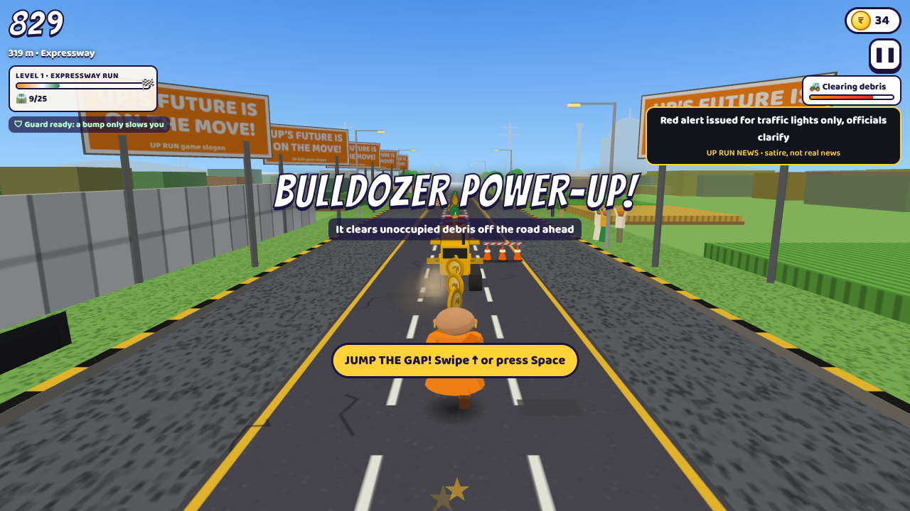
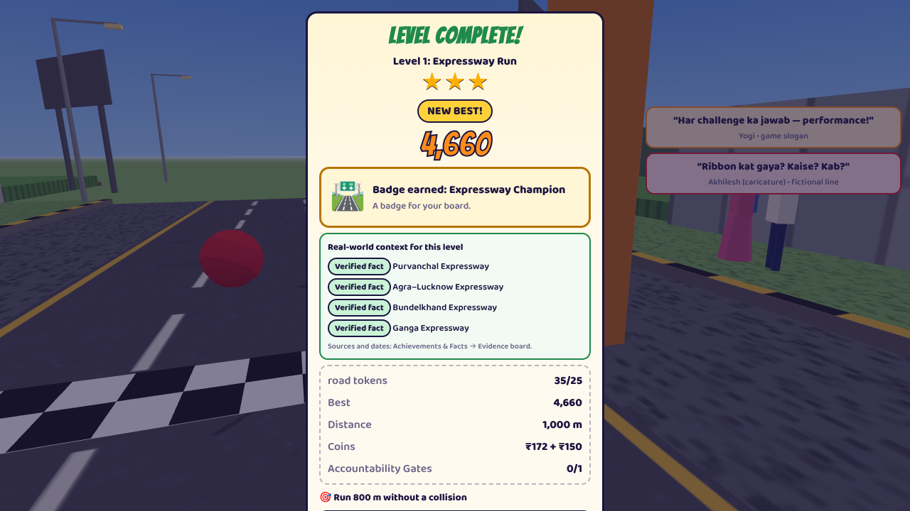
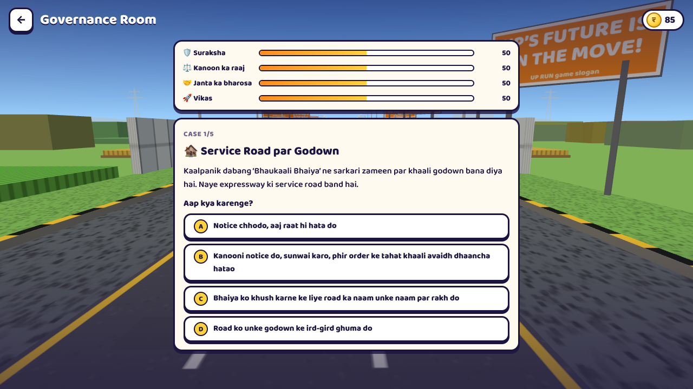
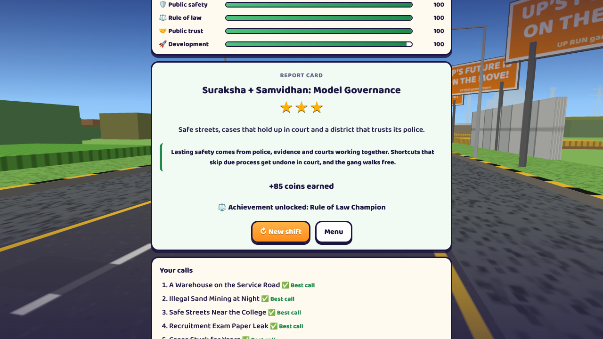

# UP RUN: Development vs. Gundaraj

A fan-made, pro-BJP political satire runner in the style of Subway Surfers. It is set in a fictionalised Uttar Pradesh and runs in the browser on phones and laptops.

You run as a **Yogi Adityanath-inspired hero** (saffron robes, dramatic entrance, victory pose) through eight development levels. Along the way you collect development tokens, pass Accountability Gates, win Red Cap Challenges and race the **Akhilesh Yadav-inspired rival** (red cap) in a Development Race. In **Rivalry Mode** you play the rival: a Political Challenge ends in the hero's entrance and a stylised-bulldozer **Governance Showdown** that you must escape.

> **Disclaimer.** UP RUN is fan-made political satire. It is **not an official app** and is not affiliated with or endorsed by the BJP, the Samajwadi Party, the Government of Uttar Pradesh or any politician. Characters are cartoon caricatures, and negative roles go only to fictional characters. All dialogue and slogans were written for the game, so there are no real quotes. **Game scores are fictional.** Real-world information is labelled as a *verified fact*, a *government-reported figure* or a *political claim*, with sources (see [`docs/SOURCES.md`](docs/SOURCES.md)). The bulldozer is a game symbol: it never touches a person, never demolishes a home, and only pushes unoccupied debris off the road.

**▶ Play online: https://irijournal.github.io/Game/** (works on phones and laptops)

| Start | Gameplay | Level complete |
|---|---|---|
|  |  |  |

| Governance Room (Hinglish) | Governance report card |
|---|---|
|  |  |

Every push to the main branch rebuilds the game and republishes the site (`.github/workflows/deploy-pages.yml`).

---

## Quick start

```bash
npm install
npm run dev          # http://localhost:5173  (add ?nointro to skip the opening)
```

Production build (static files that work from any sub-folder):

```bash
npm run build        # → dist/
npm run preview      # http://localhost:4173
```

To build a single self-contained HTML file that opens straight from disk with no server (about 1.3 MB):

```bash
npm run build:single # → dist-single/index.html
```

The live site is served by GitHub Pages from the `gh-pages` branch, which holds only the contents of `dist/`. To publish a new version:

```bash
npm run build
git worktree add /tmp/ghp gh-pages        # check out the published files
rm -rf /tmp/ghp/assets && cp -r dist/. /tmp/ghp/ && touch /tmp/ghp/.nojekyll
cd /tmp/ghp && git add -A && git commit -m "Publish new build" && git push
cd - && git worktree remove /tmp/ghp
```

Host `dist/` on any static web server: GitHub Pages, Netlify, S3, or `npx serve dist`. There is no backend, no API key, no analytics and no tracking. Progress is saved only in the browser's `localStorage`.

Requirements: Node 18+ and a browser with WebGL (current Chrome, Edge, Firefox or Safari).

## Controls

| Action | Phone | Laptop |
|---|---|---|
| Change lane | swipe ← / →, or the ◀ ▶ buttons | `←` `→` or `A` `D` |
| Jump | swipe ↑ or ▲ | `Space` / `↑` / `W` |
| Slide (in the air: fast-fall) | swipe ↓ or ▼ | `↓` / `S` |
| Pause / resume | ❚❚ button | `Esc` / `P` |
| Skip a cinematic | tap or **Skip ▸** | any key or **Skip ▸** |

The on-screen ◀ ▲ ▼ ▶ buttons appear by default on touch devices. You can switch them on or off under *Settings → On-screen touch buttons*.

**Language.** The menu's 🗣️ button (or *Settings → Language*) switches the interface between English and Roman-script **Hinglish**: menus, how-to-play, Manifesto Mayhem, the pause menu, result screens and the whole Governance Room. Sourced facts, quiz questions and the evidence board stay in English so their wording matches the cited sources.

## Modes

### Campaign: eight levels

Each level has its own environment, music, obstacles, mission, token, progress bar, reward screen and replay.

| # | Level | Environment (fictionalised) | Token | Obstacles | Badge (perk) |
|---|---|---|---|---|---|
| 1 | Expressway Run | Expressway; Agra-inspired skyline | 🛣️ road | cones, barricades, work-zone gaps, trucks | Expressway Champion |
| 2 | Ayodhya Heritage Mission | ghats, temple spires, diyas | 🪔 diya | flower carts, festival toranas, festival floats | Heritage Star |
| 3 | Airport Dash | terminals, hangars, airliners | ✈️ flight | luggage trolleys, flight boards, baggage loaders | Connectivity Boost (power-ups +25%) |
| 4 | Kisan Challenge | fields, huts, haystacks, tube-wells | 🌾 crop | broken irrigation pipes, canals, hay bales, tractors | Kisan Support |
| 5 | Jan Kalyan Mission | Varanasi-inspired town, welfare camps | 🏠 welfare | queue barriers, file piles, "DELAYED" signs | Public Service (+300 coins) |
| 6 | Law & Order Challenge | Lucknow streets | 🛡️ shield | checkpoints, traffic, fictional "GUNDARAJ?" signs | Governance Shield (guard recharges 30% faster) |
| 7 | Startup UP | Noida-inspired industrial and tech district | ⚙️ gear | pallets, conveyors, forklifts, crate stacks | Growth Multiplier (tokens +20%) |
| 8 | Viksit UP Finale | a futuristic, imagined UP at dusk | ⭐ star | hologram gates, maglev pods, drone crates | Final Champion trophy |

Stars: ★ for finishing, ★★ for also reaching the token goal, ★★★ for also having no collisions. Finishing a level unlocks the next one and that environment as a Free Run start route. Every level intro shows the real-world context as labelled fact cards with sources.

In levels and races, a bump only slows you down while the stumble guard is ready. A second hit before the guard recharges ends the run.

### Rivalry Mode

You play the rival. The **Challenge Meter** fills, a "POLITICAL CHALLENGE AHEAD!" warning appears, then the run plays a scripted stumble in slow motion. The hero makes an entrance with a stylised bulldozer and the **GOVERNANCE SHOWDOWN** begins. Dodge obstacles and grab report cards until the timer runs out. Escaping clears the stage and unlocks the next, faster one; one hit during the showdown ends the run.

### Development Race

The hero races the rival over 1,500 m on parallel lanes. Development tokens each give a +3 m boost, and stumbles cost time. The game shows a winner either way.

### Free Run

An endless run with any unlocked character. Environments rotate every 750 m, with Accountability Gates, rival challenges and power-ups along the way. Playing as the hero, the rival arrives on a giant campaign cycle instead of the bulldozer.

### Manifesto Mayhem

The rival caricature flies a campaign **cycle-copter** above the road and drops gift-wrapped crates of absurd, invented promises: "FREE MOON TRIP", "SEA BEACH IN LUCKNOW", "METRO TO EVERY VILLAGE BY TUESDAY", "EXPRESSWAY TO MARS". The crates parachute down, and a red ring marks where each will land. Dodge them for 1,200 m and collect real development tokens until the manifesto runs empty. Every promise is labelled a fictional exaggeration, not taken from any real manifesto.

The crates land on spots the normal generator has already checked are passable, so the falling is purely visual and the course stays fair.

### Governance Room

A decision mode, not a runner. You run the Governance Room of **Khushalpur, a fictional district**. Five fictional cases are dealt from a deck of eight, and each one has four possible responses:

- hafta in the sabzi mandi;
- a threatened witness;
- a strongman's empty warehouse blocking an expressway service road;
- harassment near a college;
- a recruitment-exam paper leak;
- a doctored WhatsApp video;
- illegal sand mining;
- cases stuck for years.

Every response moves four meters: 🛡️ public safety, ⚖️ rule of law, 🤝 public trust and 🚀 development. Each case has four kinds of answer:

- **Best call:** police, evidence, courts and quick delivery working together.
- **Good step:** right direction, half the job.
- **Shortcut:** for example "declare them guilty on TV", "skip the notice and clear it tonight" or moral policing. Shortcuts always cost rule of law, and the consequence shows the court undoing them.
- **Gundaraj answer** or **comic disaster:** "call it a minor matter", "forward it for awareness", "switch off the internet for a month".

The hero caricature reacts to each choice ("Kanoon se kaam, kaam se naam!").

The report card rates the shift:

| Rating | Stars |
|---|---|
| *Suraksha + Samvidhan: Model Governance* | ★★★ |
| *Good Governance* | ★★ |
| *Shortcut Sarkar* (when shortcuts sank it) | ★ |
| *Shaky Sarkar* | ★ |
| *GUNDARAJ RETURNS!* | none |

The report card also lists your calls and shows the evidence-board entries that label the real debate as political claims. Coins and the **Rule of Law Champion** achievement are awarded.

The mode makes the game's argument (lasting safety comes from due process, not shortcuts) through what the player does rather than through slogans. The cases are fictional; no real party, politician or place plays a negative role, and no option demolishes a home or punishes anyone without a case. After finishing Level 6 (Law & Order), the reward screen offers a shortcut into the Governance Room.

## Satire layer

All of this is labelled fictional satire in the game:

- **Ribbon Race.** In the last 160 m of every level, the rival caricature sprints along the shoulder with giant scissors to cut *your* inauguration ribbon. They always arrive a step too late ("Arre! Yeh to humne 2015 mein socha tha!").
- **Satirical obstacles:**
  - a **"PARIVAAR MEETING"** sofa of arguing red-cap (fictional) relatives;
  - a **"KAAM BOLTA HAI?"** board ("2017 result: 47 seats");
  - a buffering **"FREE LAPTOP 2012"** pile;
  - an **"ALLIANCE PARKING"** heap of cycles.
- **UP RUN News.** Satire headlines appear as flashes during runs and in a ticker on the menu. Examples: "Family meeting on seat-sharing enters day 3,000", "Laptop from 2012 still buffering".
- **One-liners.** The hero's catchphrases include "Kaam sirf bolta nahi — dikhta hai!" and "Rasta saaf, vikas aage!". The rival has comic comebacks after Red Cap Challenges and races.
- **Quiz and missions.** The quiz bank covers SP's 2017 slogan, the 2017 and 2022 results, the 2017 cycle-symbol ruling, the laptop scheme, ODOP and the Maha Kumbh, all from `docs/SOURCES.md`. Missions include "Deliver 12 promises (unlike some manifestos)".

## Rival encounters and power-ups

| Encounter | What happens |
|---|---|
| **Accountability Gate** | A question appears about 6 s ahead, with options A / B / C mapped to the left / middle / right lanes. Run through the correct lane for +200; afterwards a labelled fact card with sources appears. The road before each gate is kept clear. |
| **Red Cap Challenge** | The rival runs alongside on the shoulder. Get through the stretch without a stumble for +300. |
| **Promises vs Performance** | Promise scrolls appear among red-tape obstacles. Deliver at least 60% for +300. |
| **Bulldozer power-up** | A helper bulldozer drives *ahead* of you on the carriageway for 6 s and pushes unoccupied debris (cones, barricades, file piles, "DELAYED" signs) aside. |
| **Vote Magnet / Vikas Express** | Coin magnet; temporary fictional flyover (Free Run). |

## Scoreboard and achievements

The **Scoreboard** ("Performance is the real scoreboard") shows personal bests per mode and the longest run. It also tracks levels and stars, development tokens, missions, obstacles avoided, debris cleared, promises delivered, Red Cap Challenges won, Accountability Gates passed, races won, Manifesto Mayhem wins, fictional promises dodged, the best Rivalry stage and Governance Room shifts. Every score screen says that game points are fictional.

**Achievements & Facts** has four tabs: 14 achievements, the 8 level badges, the **Evidence board** (all real-world information, filterable by type, with sources and the check date) and the game's own slogans (labelled as political claims, not quotes).

## Architecture

```
src/
  content/    facts (sourced, typed), levels, quiz, fictional promises, jokes, slogans, achievements
  sim/        Pure TypeScript game logic, no rendering (unit-tested in Node)
    simulation.ts   state machine, modes, levels, encounters, scoring, spawning
    player.ts       lanes / jump / slide physics (fixed 120 Hz steps)
    collision.ts    contact classification: crash / side-bump / land
    generator.ts    procedural rows + route-validity checker + coin placement
    autopilot.ts    input-only bot used by tests and the browser soak test
  save/save.ts    versioned, validated localStorage save (v3; migrates v1/v2)
  engine/       Three.js renderer, the single RAF loop, input, audio, camera
    view/         characters, vehicles, obstacles, 8 environments, crowds,
                  encounter visuals (finish arch, gates, rival runner,
                  helper bulldozer, cycle-copter), cinematics, effects
  ui/           React screens, HUD, evidence board
tests/e2e/      browser acceptance tests (Playwright, production build)
docs/           STATUS.md, BUG_REGISTER.md, SOURCES.md
```

Key decisions:

- **Simulation separated from rendering.** The sim advances in fixed 1/120 s steps, and frame deltas are clamped to 0.1 s. 30, 60 and 120 fps therefore play the same, and a backgrounded tab cannot jump.
- **One game loop.** The engine owns exactly one `requestAnimationFrame`. Restarting replaces the simulation, never the loop.
- **Every state has an exit.** RUNNING → EVENT_PENDING → STUMBLE → CINEMATIC → CHASE → SUCCESS / FAILURE → GAME_OVER. Each has a timeout, and the cinematic is skippable with a fixed maximum length.
- **Fair generator.** A chunk of obstacles is accepted only if a route exists from *every* starting lane. Quiz gates, power-up drops and the finish line reserve obstacle-free stretches. Levels use fixed courses, so 3 stars are learnable; other modes vary.
- **Content as data.** Facts, levels, quiz questions, fictional promises, jokes and slogans live in `src/content/` and can be edited without touching the game code. Each fact keeps its type, sources, dates and caveats.
- **No external assets.** Everything is built in code: characters, vehicles, scenery and crowds from primitives (merged and instanced), text from canvas textures, music and sound effects from WebAudio synthesis. Fonts are bundled.

## Tests

```bash
npm run typecheck
npm test             # 125 unit + integration tests (~3 min; one physics cross-check is slow)
npm run build && npm run e2e   # 19 browser scenarios against the production build
E2E_ONLY="Rivalry|Mayhem" npm run e2e   # run a subset by name
```

The unit tests cover:

- Physics and collision classes, and the generator and route validator (10,000 chunks, plus a real-physics cross-check).
- Coins never inside obstacles, and no long stretch without coins or tokens.
- Every level's fixed course is completable and supplies ≥ 1.8× its token goal.
- Gates keep their approach clear and score by lane.
- Red Cap and Promises encounters; the bulldozer power-up touches only debris.
- Race balance at the production pace.
- The rivalry warning → stumble → entrance → showdown → next stage flow.
- A state-machine fuzz test, scoring, and save validation and migration (v1 and v2 → v3).
- Content integrity: sources, references, and SP-era credits.
- The Governance Room, checked on every possible five-case shift:
  - each case has exactly one best answer, and it is the due-process one;
  - shortcuts always cost rule of law;
  - best calls always earn 3 stars, Gundaraj answers always end in "Gundaraj returns", and shortcut-heavy shifts are rated Shortcut Sarkar;
  - no case names a real party, politician or place, and no option demolishes a home;
  - the language setting is validated.

The browser scenarios cover:

- Intro → Level 1, keyboard (arrows / A D / Space / W / S / Esc), and phone swipes plus touch buttons.
- **All 8 levels finished to their reward screens**, and an Accountability Gate answered with its fact card.
- The full Rivalry sequence escaped, and a showdown lost then retried.
- The bulldozer power-up, the Development Race, Free Run with the cycle, and Manifesto Mayhem (crates falling, manifesto emptied).
- A full Governance Room shift (five cases to a 3-star report card, saved with its achievement), and the Hinglish switch (it survives a reload).
- Every menu button, the evidence-board filter and source links.
- Save persistence and corrupt-save recovery, rotation, background-tab pause, and the no-WebGL screen.
- Audio, and a 15-game-minute soak. Every scenario also fails on any console or page error.

Screenshot tools: `node dev/walkthrough.cjs [desktop|phone]` and `node dev/tour.cjs [desktop|phone] [levels|modes]` (after `npm run build`; output in `dev/shots/`). `dev/obstacles.html?kinds=…` and `dev/preview.html` (via `npm run dev`) show obstacle and character galleries.

See `docs/STATUS.md` for what each requirement's evidence is, and `docs/BUG_REGISTER.md` for bugs found and fixed. Real-device testing (iOS Safari, Android Chrome, Firefox, desktop Safari) has **not** been done. The automated runs use headless Chromium with software WebGL.
